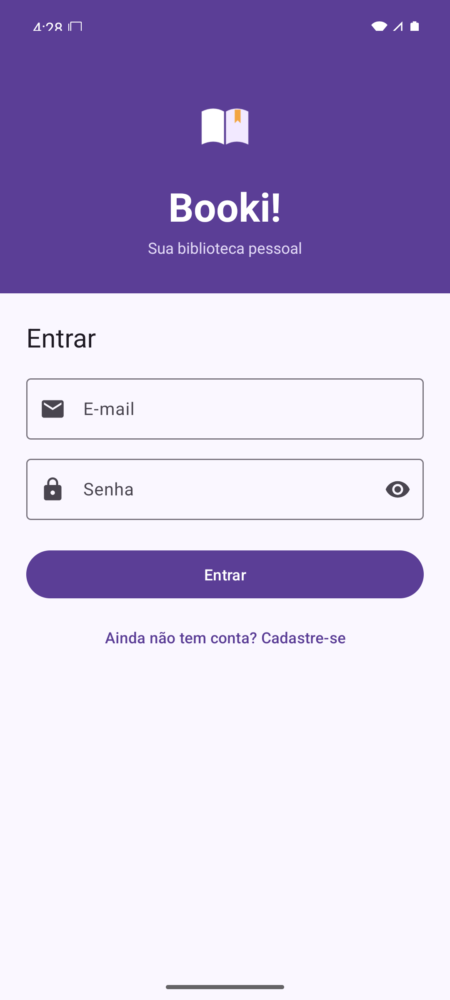
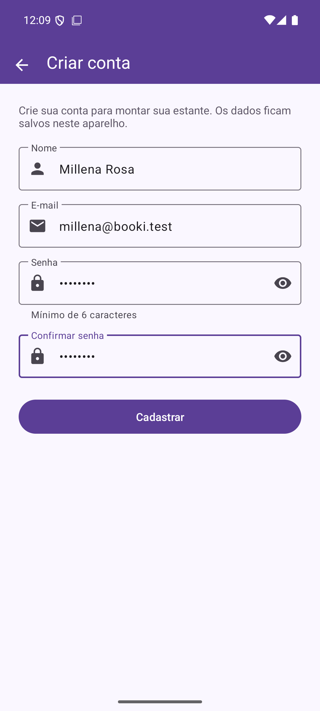
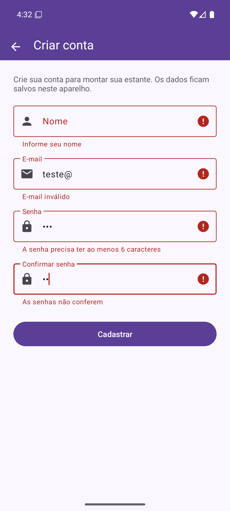
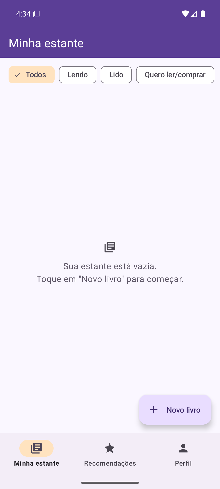
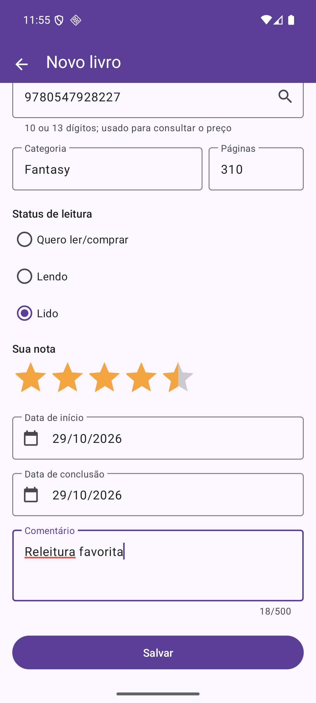
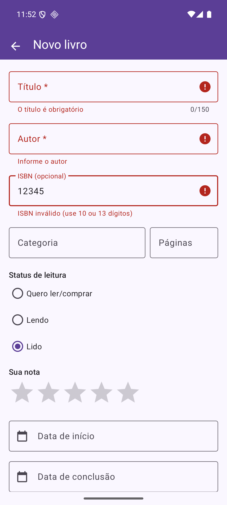
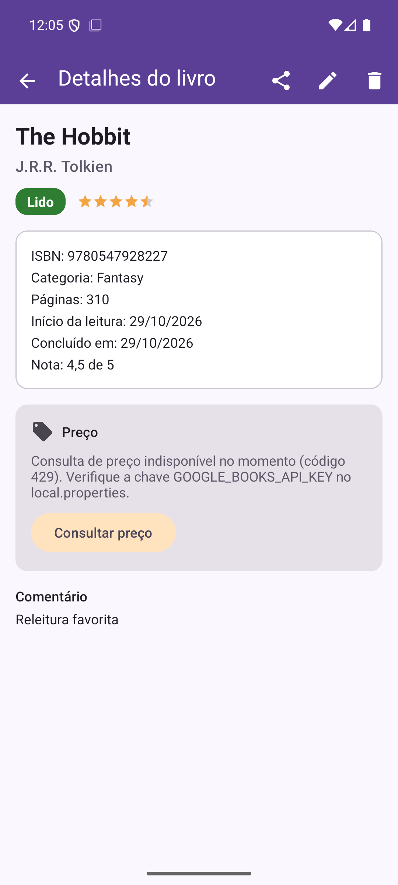
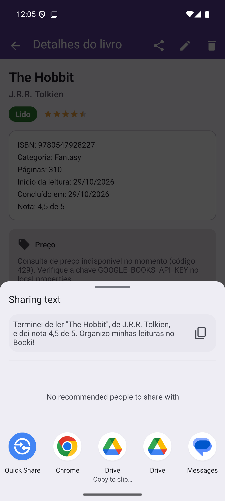
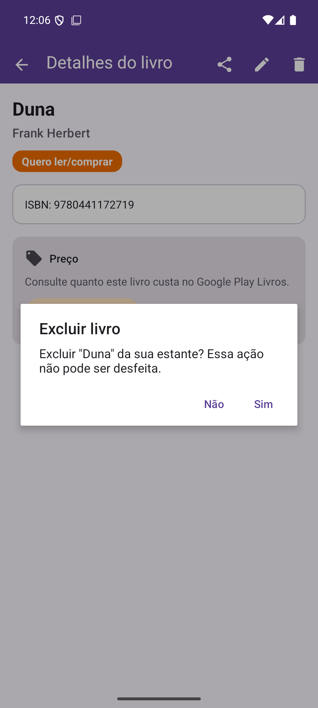
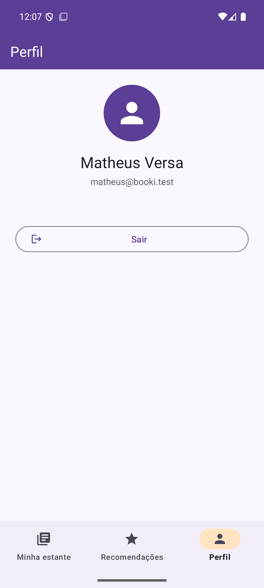

# Telas do Booki!

Capturas feitas no emulador Android (Pixel 7, Android 16 / API 36), com o app rodando a versão de `develop` depois dos testes.

## Login e cadastro

| Login | Cadastro de usuário | Validação do cadastro |
| --- | --- | --- |
|  |  |  |

## Estante e cadastro de livros

| Estante vazia | Novo livro (Lido, com nota e datas) | Validação do livro |
| --- | --- | --- |
|  |  |  |

No formulário, a lupa do campo ISBN preencheu título, autor, categoria e páginas pela Open Library. O calendário não deixa escolher datas futuras.

| Minha estante | Filtro por status | Detalhe e preço |
| --- | --- | --- |
|  |  |  |

Sem a chave `GOOGLE_BOOKS_API_KEY`, o Google Books recusa a consulta (código 429) e o app mostra o aviso no cartão de preço, sem travar.

## Ações sobre o livro e perfil

| Compartilhar (ACTION_SEND) | Excluir (com confirmação) | Perfil |
| --- | --- | --- |
|  |  |  |
